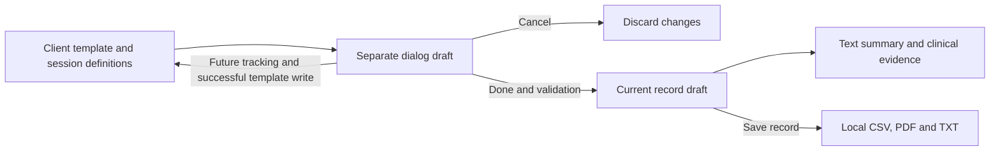

# Local data contract

EzEMR stores and exchanges local files. None of the formats below initiates a network connection. CSV and backup JSON preserve the source record model; they are not FHIR resources, OMOP tables, or openEHR compositions. A receiving system needs an explicit, reviewed mapping.

## Identity and clinical values

Client `id`, session `id`, item IDs and field IDs are stable identifiers. `ref` is the medical record number; names are display values. A session ID is unique within its client. Record validation accepts ASCII alphanumeric identifiers with underscores or hyphens, up to 120 characters, excluding prototype-property names.

Before a backup restore writes any data, EzEMR validates all clients, sessions and optional settings. Duplicate client IDs, duplicate session IDs within a client, and medical record numbers that collide under the application's folder-name normalization are rejected. An incoming client ID cannot refer to a different existing medical record number. These checks establish internal identity consistency; they do not authenticate a person.

Clinical text, custom names, original filenames, option values, units, zero values and missing values retain their source meaning when the interface language changes. Numeric zero is a result; null or an absent field represents missing data. Assessment and training definitions stored with a session describe that session's fields. An assessment with `done: false` or a training item with `on: false` retains its draft data but is excluded from the clinical report and record-text search.

## Assessment definitions and result editing

Assessment definitions live in `client.plan`; record-specific definitions live in `session.assessmentPlan`. Each item has a stable `id`, display `name`, function category, outcome period and `fields`. Each field has a stable `id`, source `label`, type (`text`, `number`, `textarea`, or `select`), and optional unit, numeric bounds/step, options, measurement phase or settings group. Results live separately in `session.assess[itemId]`, with `done`, `values[fieldId]`, notes, and optional measurement references. COPM retains its dedicated activity/score rows.

`fieldsFor` resolves the field definitions. `fieldInputs` and `readAssessmentEntry` render and read the dialog using those definitions; `assessmentResultHTML` renders escaped text from the committed record. `assessmentResultForm` owns a separate draft and any added fields. The main record collector reads committed assessment state, so opening, typing in, or canceling a dialog does not leak partial results into clinical evidence or exports. Editing a selected item does not enable matching historical results that were excluded.

Done validates the form and references, saves any explicitly requested template additions, and then updates the record draft and text summary. Cancel discards the dialog draft and pending field definitions. A failed template write leaves the original results intact and permits retry. Done does not save the entire clinical record; the existing record Save action does that. A browser or OS interruption after a template write is not an atomic transaction across the template and record files.

To add an ordinary custom assessment, supply a definition using the existing field types; no assessment-ID branch is needed in the dialog or summary. Add a new field type only with matching rendering, reading, validation, text output and bilingual browser coverage. Stable IDs, session snapshots, canonical option values, unknown legacy result keys, zero values and clinical text must survive the existing CSV/JSON contracts. This UI change does not introduce a schema version or migrate stored records.

Matching standard and imported items keep their own result IDs and values. The editor remembers each group's selection entry for the current record, so deselecting an empty standard item does not replace its checkbox with an imported item. This display state is temporary and is not written into the clinical schema.

## Local folder files

| File | Contract |
| --- | --- |
| `clients.csv` | UTF-8 roster, schema version `1`, one row per client. Explicit columns include identity, folder, demographics and plans; `extra_fields` retains additional profile fields. Folder names are local path components, not patient identity keys. |
| Session `.csv` | UTF-8 with BOM; columns `schema_version,section,field,type,value`. Version `1`; `section` is `client` or `session`. Nested paths use JSON Pointer escaping (`~0` for `~`, `~1` for `/`). Containers have a typed row and subsequent child rows. |
| Session `.pdf` and `.txt` | Human-readable clinical reports generated from a session. They are not imported as the source record. |
| `settings.json` | Version `1`, with a `requiredFields` array of supported profile field keys. |

Session CSV types are `object`, `array`, `string`, `number`, `boolean` and `null`. Strings that could be spreadsheet formulas receive a reversible leading apostrophe. The reader removes that prefix; consumers should use the supported reader rather than guessing types from the visible cell text. The roster and session CSV have different schemas.

## Plain backup JSON

The current root object has `app: "vision-rehab-notes"`, `version: 2`, an ISO `exported` timestamp, `settings`, and `clients`. Each client includes its `sessions` array. Other client and session properties retain the application's source representation, including custom fields and import provenance.

Version `1` and legacy backups without `app`, `version` or `settings` remain readable. A missing settings object leaves existing settings unchanged. Explicit unknown applications or versions are rejected. A UTF-8 BOM is accepted. This is a saved-data backup; it excludes an unsaved editor draft and remembered folder handles.

The interface reviews counts before writing. Matching client profiles and session IDs require explicit overwrite agreement. Records outside the backup are retained. Included profile settings are restored. Cancellation writes nothing. A storage error stops subsequent writes; the restore is not a transaction spanning all clients. Keep a separate backup before overwriting existing records.

## Encrypted backup JSON, version 1

| Field | Required value or encoding |
| --- | --- |
| `app` | `EzEMR-encrypted-backup` |
| `version` | `1` |
| `cipher` | `AES-GCM` |
| `kdf` | `PBKDF2-SHA-256` |
| `iterations` | `600000` |
| `salt` | Standard Base64 encoding of 16 random bytes |
| `iv` | Standard Base64 encoding of 12 random bytes |
| `data` | Standard Base64 encoding of ciphertext followed by the 16-byte authentication tag |

The plaintext is UTF-8 JSON in the plain backup format above. PBKDF2 uses the exact UTF-8 password, without trimming or Unicode normalization, to derive a non-extractable 256-bit AES key. AES-GCM uses a 128-bit tag and the UTF-8 additional authenticated data `EzEMR-encrypted-backup:1`. A fresh salt and IV are generated for each encryption. Supported metadata is checked before password derivation, including the exact iteration count, to reject unsupported or excessively costly parameters.

The create-backup interface requires at least 12 Unicode characters and confirmation. The application does not persist the password or key. Decryption failure reports a wrong password or damaged file and permits retry or cancellation. Decryption alone does not write data; the decoded backup must also pass record validation and the restore review. The browser's [Web Crypto encryption](https://developer.mozilla.org/en-US/docs/Web/API/SubtleCrypto/encrypt) and [key derivation](https://developer.mozilla.org/en-US/docs/Web/API/SubtleCrypto/deriveKey) APIs perform these operations locally.

Encryption covers only this backup file. Local clinical files, regular backups, workbooks and browser records remain plaintext. This format provides neither user authentication, role permissions, author signatures nor an immutable audit trail. File access remains subject to the computer's account and folder permissions.

## Future standard mappings

Choose a receiving implementation guide and terminology set before introducing a standards export. Document each source field, target element, unit, missing-data rule, transformation and unmapped field. Preserve original clinical text and provenance separately from mapped codes. Clinical reviewers must approve terminology and measurement mappings, and a suitable independent validator must check the output. A renamed JSON wrapper is insufficient to establish interoperability.

The [research review](RESEARCH_IMPROVEMENTS.zh-TW.md) records the evidence behind these priorities. Automated contract checks are in `tests/backup-safety.cjs`, `tests/import-identity.cjs`, `tests/imports.cjs`, `tests/profile-storage.cjs` and the existing CSV/export tests. They run through the shared CI runner and pre-push hook.
